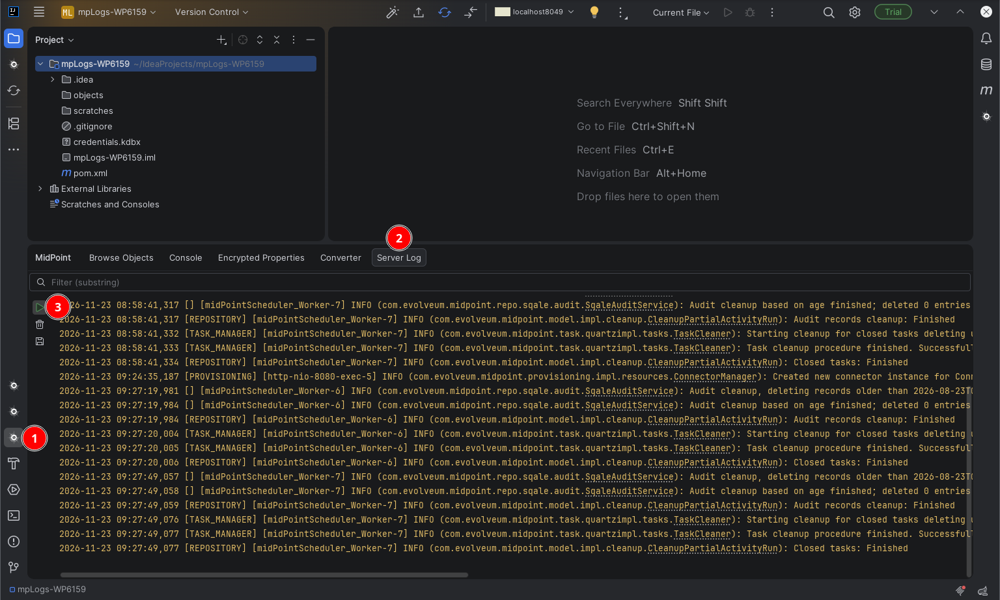

= MidPoint server log in MidPoint Studio
:page-nav-title: Server log
:page-toc: top
:page-description: This article describes the log tailing feature of MidPoint Studio.
:page-keywords: log, studio, tail, server, server log, jetbrains, intellij, idea

MidPoint Studio can tail the log file of a running midPoint server directly in the IDE.

== Access server log in MidPoint Studio

The Server Log tab is part of the MidPoint tool window, next to Browse Objects, Console and Encrypted Properties.
It reads the log over the midPoint REST API (`GET /ws/rest/log`).

.To use this feature, you need MidPoint Studio 4.11 or newer.
[NOTE]
====
See link:https://plugins.jetbrains.com/plugin/13809-midpoint-studio/versions/stable[MidPoint Studio versions] on the JetBrains marketplace.
link:https://plugins.jetbrains.com/plugin/13809-midpoint-studio/versions/snapshot[Snapshot versions] are supported as well.
See xref:/midpoint/tools/studio/builds/#adding-plugin-repository[Adding plugin repository] for instructions on installing a snapshot version.
====

To start tailing midPoint server log in IntelliJ IDEA with MidPoint Studio:

. Click the *MidPoint* button at the bottom of the left sidebar.
. Select the *Server Log* tab.
. Click the [.nowrap]#icon:play[] *Start tailing*# button.

.Steps to access midPoint server logs in IntelliJ IDEA MidPoint Studio

No server-side setup is needed beyond REST access.
The user needs the `rest-3#getLog` and `rest-3#getLogSize` authorizations (users with `#all` need nothing more).

== Toolbar and controls

* *Start/Stop Tailing* (toggle): starts polling the selected environment's log.
Shows the last 64 KB, then streams new entries every 3 seconds.
Keeps running while the tab is hidden.
Enabled only when an environment is selected.
* *Clear*: empties the view and the in-memory buffer.
Does not affect polling or an active recording.
* *Record to File* (toggle): writes the log to a project file while tailing, see below.
* *Filter field*: case-insensitive substring filter, applied retroactively to everything fetched.
It matches whole log entries, so filtering on an exception message shows the full stack trace.
Clearing the field restores the full view.

== Display

* Entries are colored by log level (ERROR, WARN, INFO, DEBUG, TRACE) using the IDE color scheme.
Multi-line entries such as stack traces are grouped and colored as one unit.
* Log file rotation on the server is detected automatically.
A marker line is shown and the tail restarts on the new file.

== Record to file

* Each recording session creates a new timestamped file: `<project>/logs/<EnvironmentName>_<yyyyMMdd-HHmmss-SSS>.log`
* The file starts with the current view content, then everything received is appended.
Content is always unfiltered, the filter only affects the view.
* A session ends when Record is toggled off or tailing stops.
Restarting while Record is on begins a new file.
* Files roll over at a configurable size, keeping a configurable number of pieces (`.1`, `.2`, ...).
Rotation markers are written into the recorded file too.

== Settings

Available under Settings, MidPoint Studio, Server log:

* Poll interval (default 3 s)
* Initial tail size (64 KB)
* Max chunk size per poll (1 MB)
* In-memory buffer size (2000 entries)
* Capture file max size (10 MB)
* Capture files kept (5)
* Entry start pattern: regular expression identifying the first line of a log entry.
Adjust it when the server uses a non-default logging pattern (custom timestamp format, or timestamp not first on the line).
Empty means every line is treated as a separate entry.

== Behavior notes

* Switching environments stops the tail, clears the view and closes any recording.
Nothing carries over between environments.
* On connection loss the tail retries automatically with an increasing interval (up to 60 seconds) and resumes where it left off.
The status shows a live countdown to the next attempt.
Authentication and authorization failures stop the tail with an explanatory message.
* REST communication logging (Console tab) is never fed by log polling, regardless of the "Log REST communication" setting.

== Limitations

* In a clustered deployment the log shown is that of whichever node answers each request.
* Log files already rotated away on the server are not accessible.